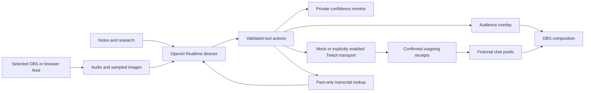

# How Producer works

Producer runs on one computer. One ongoing Realtime director makes editorial choices for the presenter and audience; local code owns execution and state.

## Input and model context

The helper serves the setup page and two browser surfaces on loopback. The selected input is pinned at Start. Native OBS input arrives as MPEG-TS over a second loopback port; FFmpeg decodes its audio mix and sampled pictures. Browser microphone/camera/tab sources use the browser's explicit media selection instead.

Audio reaches Realtime as half-second 24 kHz mono packets. When a picture exists, one source image is sampled about every four seconds. Consideration opportunities occur during the stream; they do not require the model to update a screen. Notes, an optional research packet, allowed local images, current screen state and the selected show's history provide context.

The model's [prompt](../producer/realtime_prompt.md) defines its job. Editorial timing, topic selection and whether to stay quiet belong to the model. Local code does not impose a fact quota, mandatory gap or permanent priority for a particular type of card. It does enforce payload/source/session boundaries and supported actions.

## Screen and production routing

The director uses explicit tools to show, replace or clear content, retrieve earlier transcript passages, and request eligible production actions. The optional consulting editor runs separately only when the director requests deeper advice; it does not approve routine screen choices.

Private confidence cues and public graphics have separate destinations. Shared question state lets both surfaces show the same selected audience question. Visible comments are observations tied to a recent submitted source image. Source association proves the frame was available, not that the model read every character perfectly.

The simulated chat generator supplies only painter input. It does not provide a hidden transcript or future event schedule to the director. Confirmed outgoing Producer messages are merged into future overlay pixels. The director is guided to recognize its own delivery echoes and avoid recycling them as new viewer contributions.

Offline is the default and uses the mock Twitch transport. Live production needs both helper enablement and an explicit per-show choice. The live path permits current-public-output sharing and reviewed plans. The adapter checks identity/capability, payload bounds and delivery results; a durable ledger protects against repeating actions. Failure or an uncertain result is not a license to retry a public write blindly.

## State and lifecycle

The source clock governs input chronology and transcript lookup. A selected-show transcript is written locally and can be queried only for relevant past passages from that show. Stop, source failure and stale-session checks prevent late responses from changing a newer output. Pause/Resume retains show identity and materials; End completes the show.

Queues and media buffers are bounded. Provider, decoder and source errors are visible; the helper does not silently substitute another device, service or model. The browser control page must remain open, although it can lose focus. The current Realtime session limit is 55 minutes; continuation requires explicit Resume.

## Code map

| Area | Main files |
| --- | --- |
| Loopback HTTP, setup and lifecycle | `producer/server.py` |
| Realtime protocol and prompt | `producer/realtime_director.py`, `producer/realtime_prompt.md` |
| Model tools and show state | `producer/director_runtime.py`, `producer/director_production.py` |
| OBS transport | `producer/obs_capture.py` |
| Browser capture and surfaces | `producer/static/director.js`, `room.js`, `on-air.js` |
| Shared visual components | `producer/static/design-system/` |
| Materials and transcript | `producer/show_materials.py`, `producer/transcript.py` |
| Visible chat | `producer/screen_chat.py`, `screen_chat_overlay.py`, `simulated_chat.py` |
| Twitch and mock execution | `producer/production.py`, `platform_twitch.py`, `rehearsal.py` |
| Recorded input and action replay | `producer/recorded_source.py`, `action_trace.py`, `action_replay.py` |

Some compatibility modules remain because historical fixture and replay semantics are deliberately preserved. Their presence does not mean the active director runs the older multi-stage editorial pipeline. Tests should establish active routing before changing shared code.

## Evidence boundaries

Unit and browser tests exercise deterministic routing with fixtures. A recorded-show inference run evaluates model behavior on selected media. Saved-action replay evaluates how code translates the same returned actions into state and pixels. These are different tests.

Native OBS/OpenAI input and screen output have been exercised. One explicitly authored post has separately traversed the real production dispatcher and received a Twitch delivery confirmation. That does not prove a complete autonomous live broadcast or long-session editorial quality. Keep those distinctions in release notes and demonstrations.
